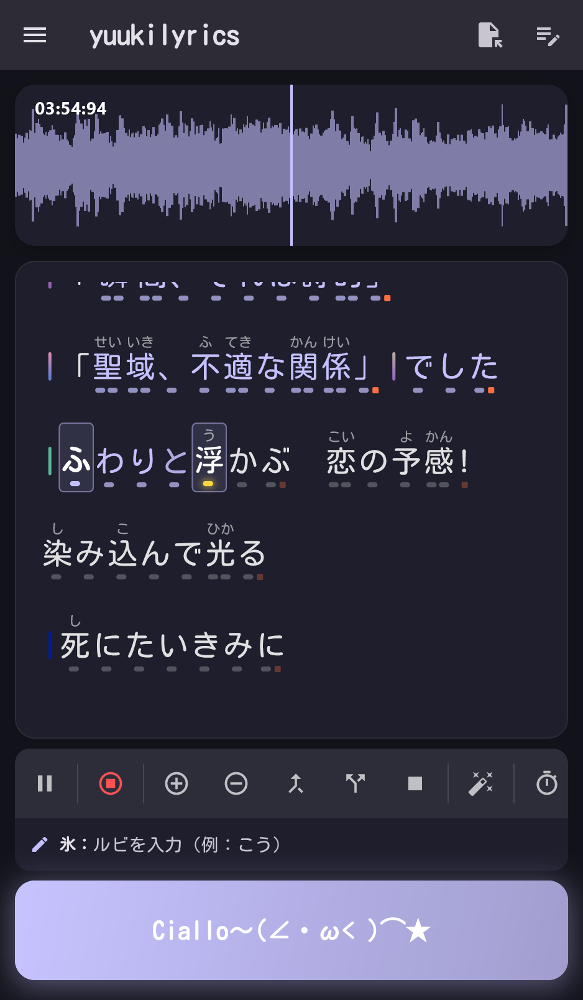
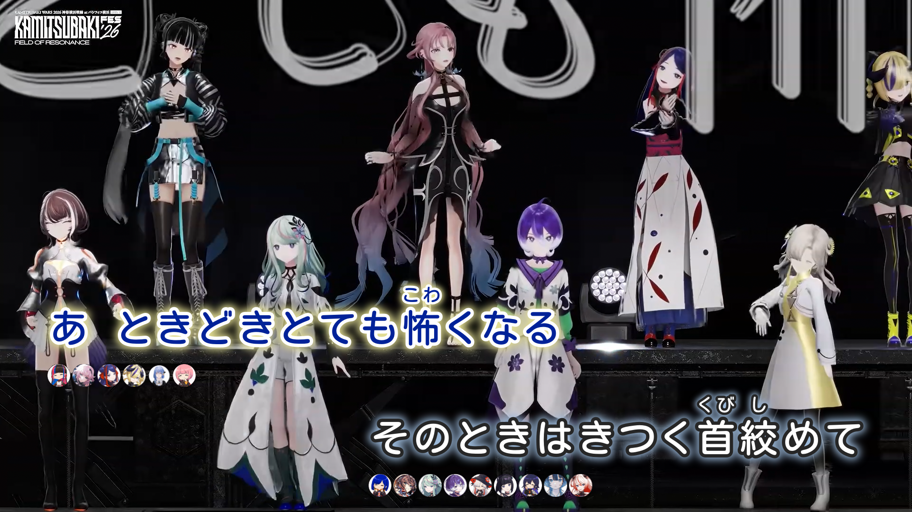
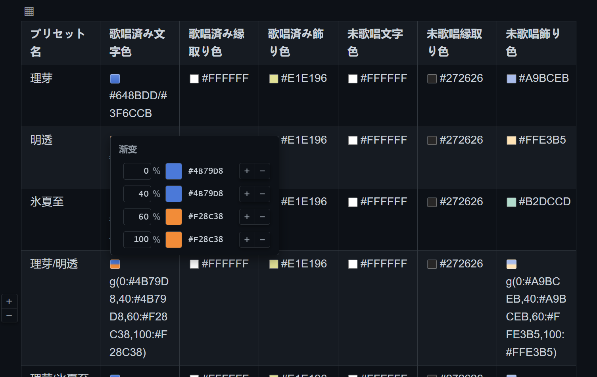

# YuukiLyrics

YuukiLyrics is a karaoke lyric editor for desktop and mobile. Time lyrics against audio or video, edit Japanese furigana, and export styled ASS subtitles or a video with the subtitles burned in. The editor supports RhythmicaLyrics-style timing notation.

**[Download the latest release](https://github.com/asuharayuuki/yuukilyrics/releases/latest)**



## Install

Choose the package for your device from the release page.

| Platform | Package | How to run |
| --- | --- | --- |
| Windows x64 | `-windows-x64.zip` | Extract the entire ZIP and run `yuukilyrics.exe` from the extracted folder. |
| macOS (Apple silicon and Intel) | `-macos-universal-release.zip` | Extract the ZIP and open `yuukilyrics.app`. |
| Linux x64 | `-linux-x64-release.tar.gz` | Extract the archive and run `yuukilyrics` from the extracted folder. |
| Android arm64 | `-android-arm64-release.apk` | Install the APK on your device. |
| iOS arm64 | `-ios-arm64-unsigned.ipa` | Sign and sideload the IPA before opening it. |

### FFmpeg

- **Windows:** Install an [FFmpeg](https://ffmpeg.org/download.html) build with libass and add it to `PATH`. The official ZIP does not include a standalone `ffmpeg.exe`. Waveform extraction, ASS style previews, and video export use this executable.
- **macOS and Linux:** Install `ffmpeg` and make sure the app can find it on `PATH` for waveform extraction. ASS style previews and video export use the bundled FFmpegKit runtime.
- **Android and iOS:** FFmpegKit is included. No separate FFmpeg installation is needed.

## Quick start

The interface is available in Japanese and Simplified Chinese.

1. Open an audio or video file and load lyrics from a `.lrc` or `.txt` file. You can also paste lyrics in the text editor.
2. Open the timing editor. Use the waveform and playback speed controls to find where the vocals start. Use **Auto Ruby & Checks** to add Japanese furigana and timing points, or set them manually.
3. Record timestamps as the song plays. Use the text editor to edit the underlying timing tags and furigana directly.
4. Open **ASS Export**, adjust fonts, layout, and singer colors, then preview the subtitles over the loaded media.
5. Export timed lyrics as text or save the `.ass` file. When the loaded media is a video, you can also export a copy with subtitles burned in.



## Styling and libraries

- Assign singer colors and avatars, and store reusable color presets. Edit palettes as Markdown or import colors from NicoKaraMaker3 projects.
- Choose separate fonts for Latin text and Japanese lyrics, with controls for furigana size, outlines, spacing, and line fades.
- Use **Escape Pod** in the About dialog to export or restore a ZIP of fonts, singer avatars, and color presets.

Use the [online Markdown style editor](https://scheme.suisei.eu.org/) to edit singer palettes in your browser.



## Check for updates

YuukiLyrics checks GitHub for a new stable release at startup. When an update is available, the dialog shows the release notes and offers a button to open the release page in your browser. To check manually, open **About → Check for Updates**.

## Build from source

CI uses **Flutter 3.47.0**. Install Flutter and the native toolchain for your target platform, then run:

```sh
git clone https://github.com/asuharayuuki/yuukilyrics.git
cd yuukilyrics
flutter pub get
flutter run
```

To build for a specific platform:

```sh
flutter build windows --release
flutter build macos --release
flutter build linux --release
flutter build apk --release --target-platform android-arm64
flutter build ios --release --no-codesign
```

Build iOS and macOS targets on macOS. The iOS command produces an unsigned app. See the [CI workflows](.github/workflows/) for platform dependencies, packaging, and signing steps. Run `flutter test` to run the test suite.

## License

YuukiLyrics is licensed under the [GNU General Public License v3.0](LICENSE).
